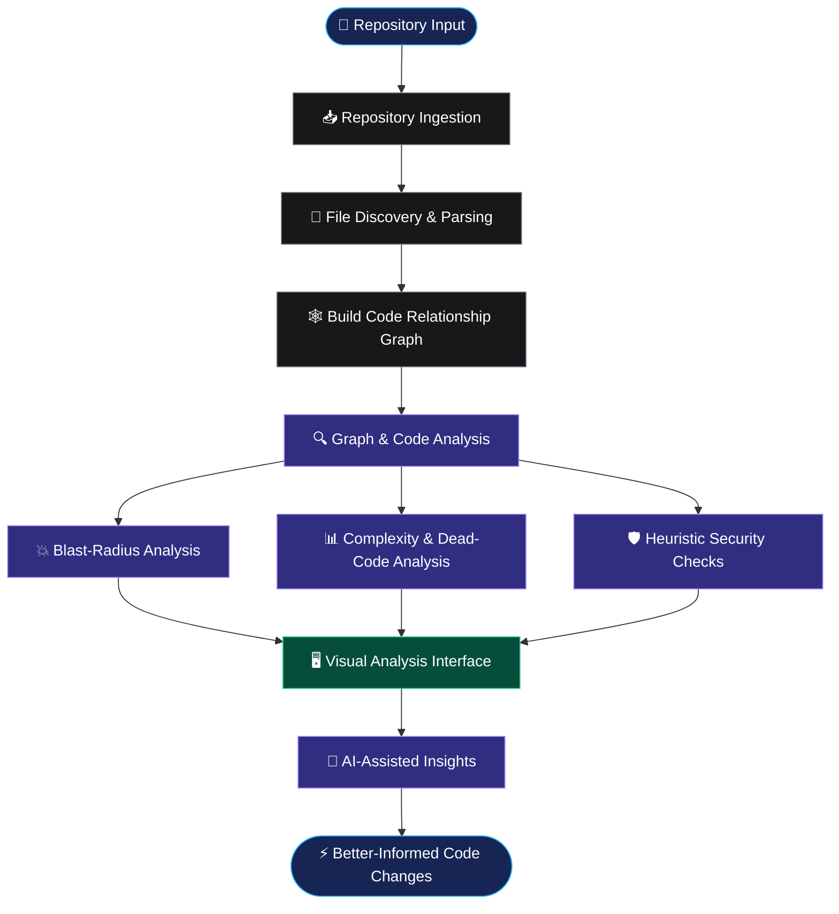
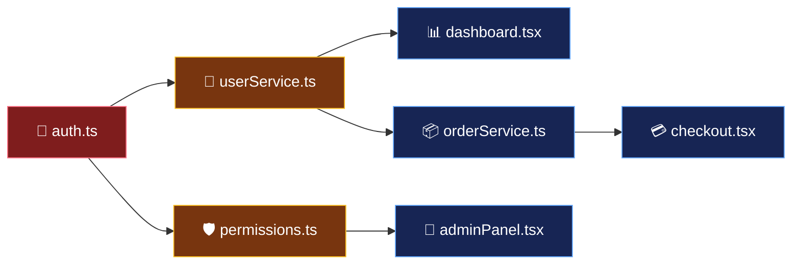
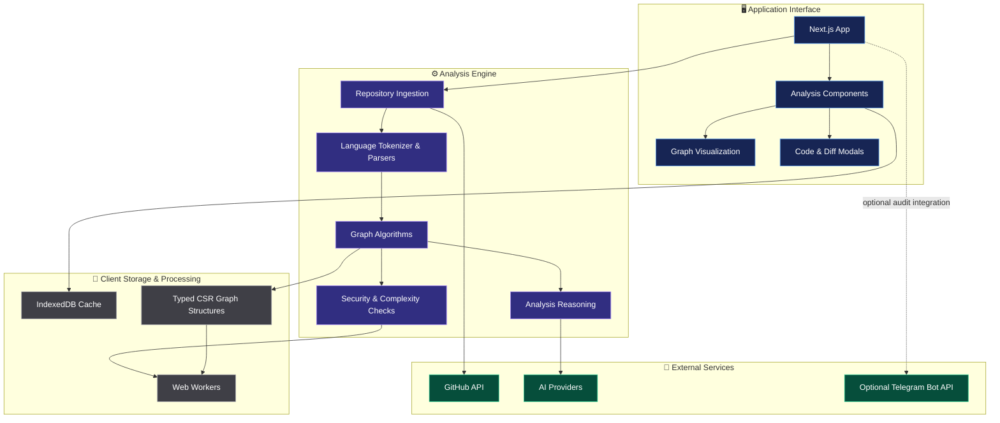

 <div align="center">

<!-- Animated title -->
<a href="https://github.com/AkshatRaj00/GitBlast">
  
</a>

### AI-Assisted Code Intelligence · Dependency Analysis · Impact Visualization

<p>
  <a href="https://github.com/AkshatRaj00/GitBlast/stargazers"></a>
  <a href="https://github.com/AkshatRaj00/GitBlast/network/members"></a>
  <a href="https://github.com/AkshatRaj00/GitBlast/issues"></a>
  
  
</p>

**Explore the connections. Understand the risks. Make smarter changes.**

[Explore Repository](https://github.com/AkshatRaj00/GitBlast) · [Report a Bug](https://github.com/AkshatRaj00/GitBlast/issues) · [Contribute](https://github.com/AkshatRaj00/GitBlast/pulls)

</div>

---

## ⚡ The Idea Behind GitBlast

Changing one file can affect many other parts of a software project. Finding those connections manually can be slow and difficult.

**GitBlast is a code intelligence project designed to help developers explore code relationships, inspect potential dependency impact, visualize repository structure, and use AI-assisted analysis to understand their codebase.**

Instead of asking only *"What does this file do?"*, GitBlast aims to help answer:

> **"If I change this file, what else could be affected?"**

---

## ✨ Explore the Engine

<table>
<tr>
<td width="50%" valign="top">

### 🕸️ Dependency Intelligence

Explore relationships between code files and investigate how dependencies may connect different parts of a repository.

</td>
<td width="50%" valign="top">

### 💥 Blast-Radius Analysis

Use graph traversal and impact-analysis algorithms to identify connected code that may deserve attention before a change.

</td>
</tr>
<tr>
<td width="50%" valign="top">

### 🧠 AI-Assisted Reasoning

Use the AI API route to generate code-related insights, with configured model providers and fallback handling.

</td>
<td width="50%" valign="top">

### 🛡️ Heuristic Security Scanning

Inspect suspicious code patterns using rule-based checks. Findings require human review and are not a guarantee of malware detection.

</td>
</tr>
<tr>
<td width="50%" valign="top">

### 🔬 Code Analysis

Explore parser utilities, complexity scanning, dead-code analysis, graph algorithms, and strongly connected components.

</td>
<td width="50%" valign="top">

### 🔗 GitHub Workflow

Connect repository analysis with GitHub-related pull-request operations. Privileged operations must be properly authorized before production deployment.

</td>
</tr>
</table>

---

## 🧬 How GitBlast Works



<sub>Conceptual workflow based on the repository's analysis modules; exact execution paths depend on the implementation and configuration.</sub>

---

## 💥 Visualizing the Blast Radius

Imagine a codebase with these relationships:



**How to read this diagram**

- 🔴 `auth.ts` — the hypothetical file being changed.
- 🟠 Direct dependencies — files that may be affected immediately.
- 🔵 Downstream connections — additional areas worth investigating.

This is an illustrative example, not a measured result from a real repository scan. Actual impact depends on the code relationships GitBlast successfully discovers.

---

## 🏗️ Architecture at a Glance



<sub>High-level architecture map inferred from the repository's modules. It is not a guarantee that every connection is invoked by every workflow.</sub>

---

## 🧰 Technology Stack

| Layer | Technologies |
|---|---|
| Application | Next.js, React, TypeScript |
| Code analysis | Tokenization, parsing utilities, complexity analysis |
| Graph algorithms | BFS, PageRank, Tarjan SCC, dead-code analysis |
| Visualization | Repository graph and analysis UI components |
| Background processing | Web Workers |
| Client storage | IndexedDB |
| AI integration | Groq and optional Mistral fallback |
| Repository integration | GitHub API |
| Optional notifications | Telegram Bot API |

---

## 🗺️ Repository Structure

```text
GitBlast/
│
├── app/
│   └── api/
│       ├── ai-brain/          # AI-assisted analysis endpoint
│       ├── github-pr/         # GitHub pull-request operations
│       └── telegram-audit/    # Optional Telegram audit endpoint
│
├── components/
│   ├── ArchitectureVitals.tsx
│   ├── BlastSidebar.tsx
│   ├── CodeModal.tsx
│   ├── DiffModal.tsx
│   ├── ForceGraphCanvas.tsx
│   ├── JarvisHUD.tsx
│   └── SecurityShield.tsx
│
├── engine/
│   ├── analysis/              # Reasoning and constant propagation
│   ├── csr/                   # Graph data structures and engine helpers
│   ├── ingestion/             # GitHub and local repository ingestion
│   ├── math/                  # Graph algorithms and impact analysis
│   ├── parser/                # Tokenization, parsing and graph building
│   ├── physics/               # Barnes–Hut utilities
│   ├── security/              # Heuristic security checks
│   └── telemetry/             # Audit and telemetry integration
│
├── storage/
│   └── repoCache.ts           # Repository cache utilities
│
├── workers/
│   ├── astGraph.worker.ts
│   └── engine.worker.ts
│
├── middleware.ts
├── next.config.ts
├── package.json
├── AGENTS.md
└── README.md
```

---

## 🚀 Get Started

### 1. Clone the repository

```bash
git clone https://github.com/AkshatRaj00/GitBlast.git
cd GitBlast
```

### 2. Install dependencies

```bash
npm install
```

### 3. Configure environment variables

Create a `.env.local` file in the project root.

```dotenv
GROQ_API_KEY=
MISTRAL_API_KEY=
GITHUB_TOKEN=
TELEGRAM_BOT_TOKEN=
TELEGRAM_CHAT_ID=
```

Add only the credentials needed for the features you intend to use. Verify the exact variable names against the current source code before deployment.

**Important:** Keep API keys and bot tokens on the server. Never expose private credentials through `NEXT_PUBLIC_` environment variables or commit `.env.local` to Git.

### 4. Start the development server

```bash
npm run dev
```

Open [http://localhost:3000](http://localhost:3000).

### 5. Build for production

```bash
npm run build
npm run start
```

Check the scripts defined in `package.json` if any command differs in your local checkout.

---

## 🔍 Core Analysis Modules

| Module | Purpose |
|---|---|
| `blastRadiusBFS.ts` | Graph traversal for impact analysis |
| `multiBlastRadius.ts` | Multi-source blast-radius analysis |
| `pageRank.ts` | Graph-based importance scoring |
| `tarjanSCC.ts` | Strongly connected component analysis |
| `deadCodeFinder.ts` | Potential dead-code identification |
| `complexityScanner.ts` | Code complexity inspection |
| `multiLangTokenizer.ts` | Language-aware tokenization utilities |
| `graphBuilder.ts` | Code relationship graph construction |
| `reasoningEngine.ts` | Analysis reasoning utilities |
| `malwareScanner.ts` | Pattern-based suspicious-code checks |
| `githubFetcher.ts` | GitHub repository file ingestion |

These modules support different parts of the analysis pipeline. Their output depends on parsing coverage, discovered relationships, configured limits, and the repository being analyzed.

---

## 🛡️ Security & Privacy

GitBlast handles source code and may interact with external services. Security is part of the engineering work, not an optional extra.

- **Authorization:** Protect GitHub write, pull-request creation, and merge operations with explicit authorization checks.
- **Credential safety:** Never expose access tokens or model API keys to the browser.
- **Input validation:** Validate repository names, file paths, request bodies, and pull-request identifiers.
- **Resource limits:** Apply file-size limits, timeouts, rate limits, and cancellation for repository ingestion.
- **Transparent telemetry:** Disclose any IP, device, or network information collected; collect only what is necessary and provide appropriate consent and opt-out controls.
- **Security findings:** Treat heuristic detections as signals requiring investigation, not proof of a vulnerability or malware.
- **AI output:** Review generated recommendations before applying code changes.

**Production status:** This README does not claim that all security controls have been independently audited or verified.

---

## 🛣️ Roadmap

- [ ] Improve dependency-resolution accuracy.
- [ ] Add broader language and syntax coverage.
- [ ] Improve incremental analysis for changed files.
- [ ] Add more tests for graph algorithms and parsing.
- [ ] Improve security findings with evidence and confidence levels.
- [ ] Reduce false positives in suspicious-code detection.
- [ ] Harden GitHub write and merge authorization.
- [ ] Add configurable repository ingestion limits.
- [ ] Improve telemetry transparency and privacy controls.
- [ ] Add automated checks to the CI pipeline.

---

## 🤝 Contributing

Contributions, bug reports, and thoughtful code reviews are welcome.

1. Fork the repository.
2. Create a feature branch.
3. Make a focused change.
4. Add or update tests where applicable.
5. Run the available checks.
6. Open a pull request with a clear explanation and reproduction steps.

```bash
git checkout -b feat/your-feature
git add .
git commit -m "feat: describe your change"
git push origin feat/your-feature
```

For bugs, include the expected behavior, actual behavior, reproduction steps, and relevant logs. Never include API keys, access tokens, or private source code in public issues.

## Contributors

Thanks to everyone whose contributions have been merged into GitBlast. This live contributor panel reflects the repository's GitHub contributor history.

<a href="https://github.com/AkshatRaj00/GitBlast/graphs/contributors">
  
</a>

---

## 📄 License

Check the repository's `LICENSE` file before redistributing or reusing this project. If no license is present, do not assume that the code is available for unrestricted reuse.

---

<div align="center">

### ⚡ GitBlast

**See the connections. Understand the impact. Change with confidence.**

<a href="https://github.com/AkshatRaj00/GitBlast">
  
</a>

<sub>Built for developers who want to understand their code before changing it.</sub>

</div>
