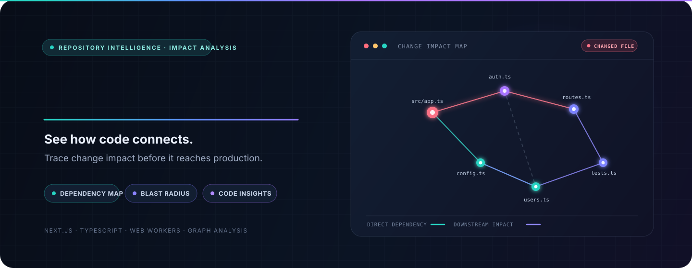
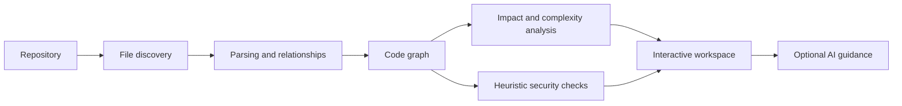

<div align="center">



<p><strong>Understand the codebase. Trace the impact. Ship changes with context.</strong></p>

<p>
  <a href="https://github.com/AkshatRaj00/GitBlast/actions/workflows/ci-cd.yml"></a>
  <a href="https://github.com/AkshatRaj00/GitBlast/actions/workflows/daily-architectural-bot.yml"></a>
  <a href="https://github.com/AkshatRaj00/GitBlast/actions/workflows/codeql.yml"></a>
  <a href="https://github.com/AkshatRaj00/GitBlast/stargazers"></a>
  <a href="https://github.com/AkshatRaj00/GitBlast/network/members"></a>
</p>

<p><a href="#get-started">Get started</a> · <a href="#what-it-does">What it does</a> · <a href="#automation">Automation</a> · <a href="CONTRIBUTING.md">Contribute</a></p>

</div>

---

## What it does

GitBlast helps developers explore a repository as a connected system. It builds a code relationship graph, highlights files that may be affected by a change, and brings analysis results into an interactive workspace.

| Capability | What you can use it for |
| --- | --- |
| **Repository mapping** | Read a repository and inspect discovered files and code relationships. |
| **Change impact** | Trace connected files and estimate a change's blast radius. |
| **Graph analysis** | Explore dependency paths, importance scores, strongly connected components, and possible dead code. |
| **Code inspection** | Review complexity signals and heuristic security findings; treat findings as leads to investigate. |
| **AI assistance** | Ask for code context and recommendations through the configured Groq or Mistral provider. |
| **GitHub workflow** | Use repository and pull request operations with a GitHub token you provide. |

GitBlast combines browser-based analysis and visualization with optional server routes for AI and GitHub operations. It does not claim that heuristic checks prove code is safe or vulnerable.

## See the analysis flow



## Get started

### Requirements

- Node.js 22 or later
- npm

### Run locally

```bash
git clone https://github.com/AkshatRaj00/GitBlast.git
cd GitBlast
npm ci
npm run dev
```

Open [http://localhost:3000](http://localhost:3000).

AI assistance is optional. To enable it, create `.env.local` in the repository root and add one or both provider keys:

```dotenv
GROQ_API_KEY=your_groq_key
MISTRAL_API_KEY=your_mistral_key
```

Keep keys server-side. Never commit `.env.local` or expose secrets through `NEXT_PUBLIC_` variables.

### Build for production

```bash
npm run build
npm start
```

## Automation

GitHub Actions and Dependabot handle repeatable checks and dependency maintenance. They report findings and create or update issues where configured; AI review workflows do not push code or merge pull requests.

| Workflow | When it runs | What it checks |
| --- | --- | --- |
| [Production build](.github/workflows/ci-cd.yml) | Pushes to `main`/`master` and pull requests | Installs locked dependencies and runs the production build and TypeScript checks. |
| [Daily health review](.github/workflows/daily-architectural-bot.yml) | Daily at **00:17 UTC**, relevant pushes to `main`, and manually | Runs the build, ESLint, and `npm audit`; stores reports and opens or updates issues for findings. |
| [CodeQL](.github/workflows/codeql.yml) | Pushes, pull requests, and weekly | Scans JavaScript and TypeScript for security issues. |
| [Dependency review](.github/workflows/dependency-review.yml) | Dependency pull requests | Checks dependency changes and fails on high-severity advisories. |
| [Dependabot](.github/dependabot.yml) | Daily | Opens dependency and GitHub Actions update pull requests. |
| [PR checks](.github/workflows/code-reviewer-bot.yml) | Pull request updates | Reports build and lint status. ESLint remains informational while the existing backlog is addressed. |
| [Gemini review](.github/workflows/gemini-review.yml) | Pull request updates | Posts AI review feedback when `GEMINI_API_KEY` is configured in repository Actions secrets. |
| [Claude review](.github/workflows/claude-review.yml) | Pull request updates | Posts AI review feedback when `ANTHROPIC_API_KEY` is configured in repository Actions secrets. |

Daily workflow runs are visible in [Actions → Daily repository health review](https://github.com/AkshatRaj00/GitBlast/actions/workflows/daily-architectural-bot.yml). Scheduled workflows run from the default branch; GitHub may delay scheduled starts during high load.

## Project structure

```text
app/          Next.js pages and API routes
components/   Interactive workspace and graph UI
engine/       Parsing, graph algorithms, security heuristics, and ingestion
storage/      Repository cache utilities
workers/      Background analysis workers
types/        Shared TypeScript types
wasm_cpp/     WebAssembly source
.github/      CI, security, dependency, and review automation
```

## Security notes

- Heuristic security results can have false positives and false negatives; verify them independently.
- AI responses are suggestions and should be reviewed before use.
- GitHub write operations require a token supplied by the user and the permissions needed for that operation.
- Never commit credentials, private source code, or sensitive repository data.

See [SECURITY.md](SECURITY.md) for reporting security issues.

## Contributing

Bug reports, pull requests, and focused code reviews are welcome. Read [CONTRIBUTING.md](CONTRIBUTING.md) before opening a change.

## Contributors

Thanks to everyone whose contributions have been merged into GitBlast.

<a href="https://github.com/AkshatRaj00/GitBlast/graphs/contributors">
  
</a>

---

<div align="center">

**GitBlast · See the connections before you change the code.**

</div>
